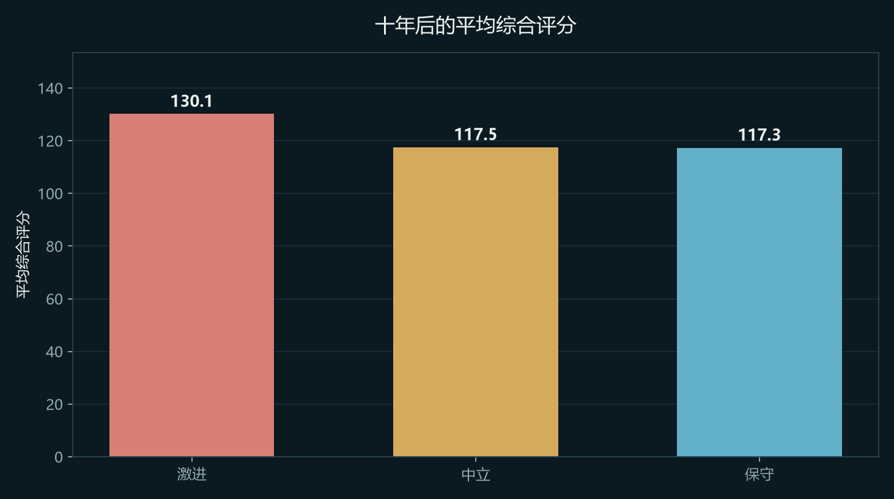
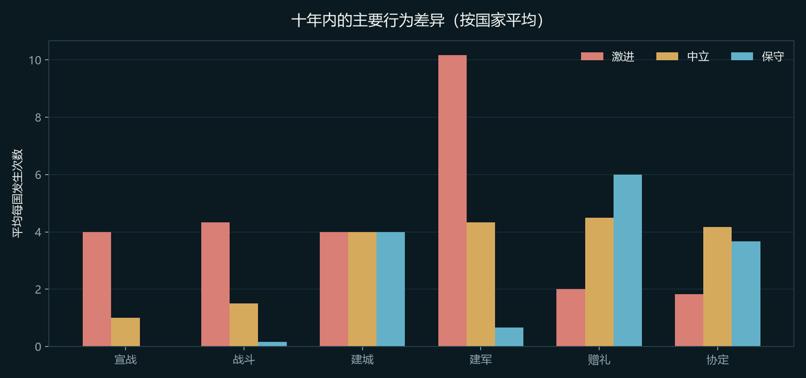
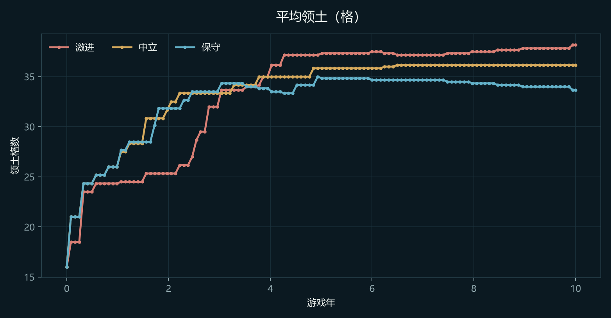
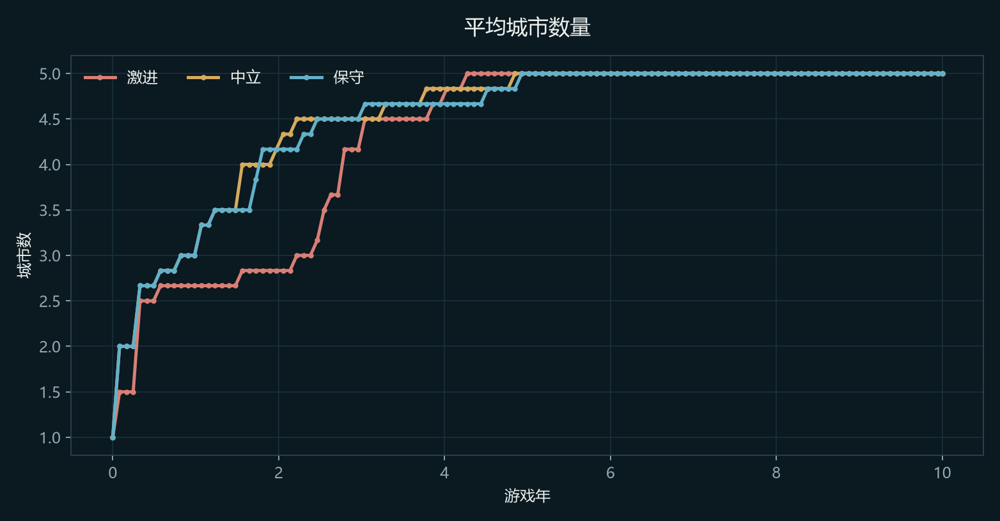
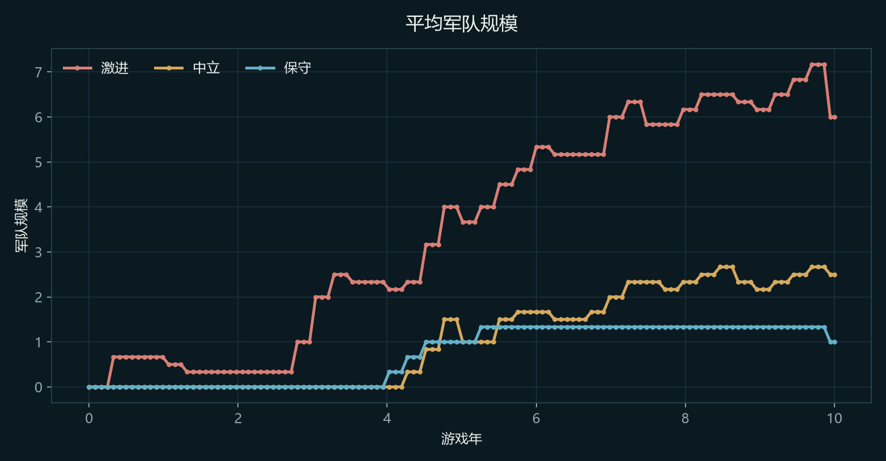
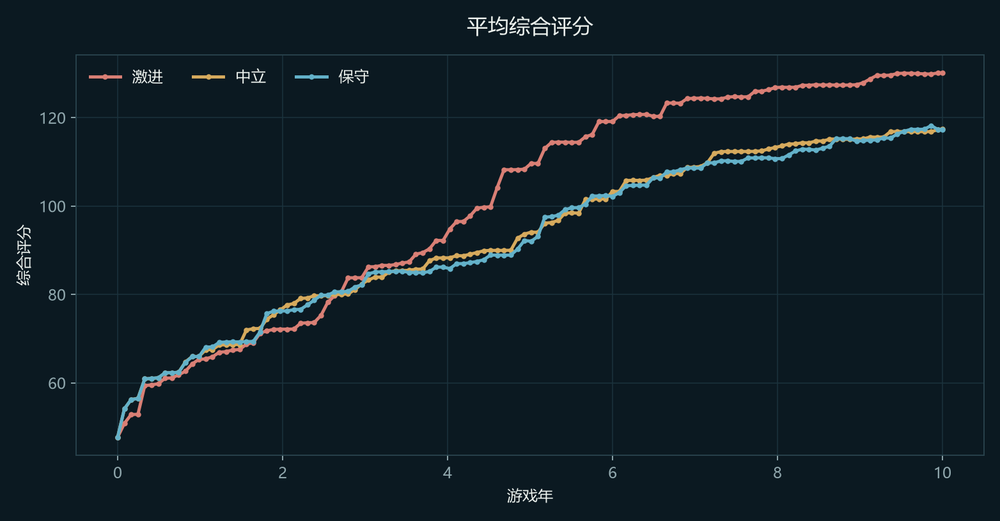
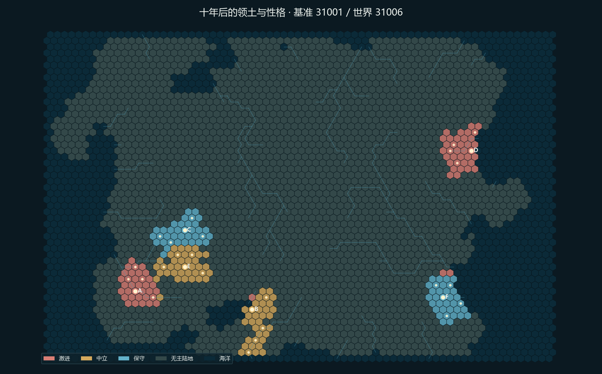

# Project Eos · AI 性格十年对照实验

> 生成时间：2026-11-10 19:29  
> 实验代码：`run_personality_experiment.py`  
> 实验模式：Mock 规则 AI（无真实模型调用）  
> 时长：每局 3,650 游戏日（10 个游戏年），每 30 日快照  
> 世界：6 国、2 激进 + 2 中立 + 2 保守，3 个公平世界轮换性格槽位  
> 数据与存档：`runs/personality_experiment/`

## 0. 结论摘要

- 十年平均综合评分最高的是 **激进**（130.1 分）；平均领土最多的是 **激进**（38.2 格）。
- 宣战次数最多的是 **激进**（24 次）；赠礼最多的是 **保守**（36 次）；协定最多的是 **中立**（25 项）。
- 平均稳定度最高的是 **保守**（65.5）；中立 65.3，激进 59.4。
- 三局结果：种子 31001：无正式胜者; 种子 42002：无正式胜者; 种子 51003：无正式胜者。
- 结论不是“某性格必胜”，而是：激进更容易把资源转成领土与军队，中立更均衡且协定最多，保守避免了主动战争、赠礼最多但领土最少；差异会受出生地、邻国和世界种子影响。

## 1. 实验设计

| 项目 | 设置 |
| --- | --- |
| 国家数 | 6（国家A–F），初始人口均为 20,000 |
| 性格分配 | 每局 2 激进、2 中立、2 保守；3 局轮换槽位，减少出生地偏差 |
| 世界 | `mapgen.generate_fair_world` 生成的公平世界 |
| 开局 | 公元前 799 年（BC800），三线科技从时代基线起步 |
| 控制器 | 全部 Mock 规则 AI，不使用 API |
| 时长 | 3,650 日，每 30 日记录一次快照 |
| 随机性 | 世界与天气由种子决定，无人工介入 |

### 1.1 三局总览

| 基准种子 | 实际世界种子 | 公平度 | 最高分国家 | 正式胜者 |
| --- | --- | --- | --- |
| 31001 | 31006 | 73.5% | 国家E（中立）· 130.2 | 无正式胜者 |
| 42002 | 42005 | 76.0% | 国家E（保守）· 129.2 | 无正式胜者 |
| 51003 | 51010 | 76.2% | 国家E（激进）· 133.6 | 无正式胜者 |

## 2. 性格聚合结果

> 每种性格 6 个观察（3 局 × 每局 2 国）。

| 性格 | 样本 | 平均分 | 平均领土 | 平均城市 | 平均军队 | 平均稳定 | 平均财政 |
| --- | ---: | ---: | ---: | ---: | ---: | ---: | ---: |
| 激进 | 6 | 130.1 | 38.2 | 5.00 | 6.00 | 59.4 | 8361.0 |
| 中立 | 6 | 117.5 | 36.2 | 5.00 | 2.50 | 65.3 | 2128.4 |
| 保守 | 6 | 117.3 | 33.7 | 5.00 | 1.00 | 65.5 | 2315.9 |



## 3. 行为差异

| 性格 | 样本 | 平均分 | 平均领土 | 平均城市 | 平均军队 | 平均稳定 | 平均财政 | 宣战 | 战斗 | 建城 | 赠礼 | 协定 |
| --- | ---: | ---: | ---: | ---: | ---: | ---: | ---: | ---: | ---: | ---: | ---: | ---: |
| 激进 | 6 | 130.1 | 38.2 | 5.00 | 6.00 | 59.4 | 8361.0 | 24 | 26 | 24 | 12 | 11 |
| 中立 | 6 | 117.5 | 36.2 | 5.00 | 2.50 | 65.3 | 2128.4 | 6 | 9 | 24 | 27 | 25 |
| 保守 | 6 | 117.3 | 33.7 | 5.00 | 1.00 | 65.5 | 2315.9 | 0 | 1 | 24 | 36 | 22 |

> “宣战/战斗/建城/赠礼/协定”是该性格 6 个国家的十年累计事件数。



## 4. 时间线

### 4.1 领土与城市

| 年份 | 激进（领土 / 城市） | 中立（领土 / 城市） | 保守（领土 / 城市） |
| --- | --- | --- | --- |
| 第 1 年（约第 360 日） | 24.3 格 / 2.67 城 | 26.0 格 / 3.00 城 | 26.0 格 / 3.00 城 |
| 第 3 年（约第 1080 日） | 32.0 格 / 4.17 城 | 33.3 格 / 4.50 城 | 33.5 格 / 4.50 城 |
| 第 5 年（约第 1830 日） | 37.3 格 / 5.00 城 | 35.8 格 / 5.00 城 | 34.8 格 / 5.00 城 |
| 第 7 年（约第 2550 日） | 37.2 格 / 5.00 城 | 36.2 格 / 5.00 城 | 34.7 格 / 5.00 城 |
| 第 10 年（约第 3650 日） | 38.2 格 / 5.00 城 | 36.2 格 / 5.00 城 | 33.7 格 / 5.00 城 |





### 4.2 军队与综合评分





## 5. 代表世界

下图是种子 `31001`（实际世界 `31006`）的十年末领土，颜色表示性格而非国家。



## 6. 逐国明细

| 种子 | 国家 | 性格 | 文明类型 | 总分 | 人口 | 领土 | 城市 | 军队 | 稳定 | 财政 | 建筑 | 宣战 | 赠礼 |
| --- | --- | --- | --- | ---: | ---: | ---: | ---: | ---: | ---: | ---: | ---: | ---: |
| 31001 | 国家A | 激进 | river_valley | 127.8 | 23093 | 35 | 5 | 1 | 60.7 | 5118.3 | 35 | 3 | 4 |
| 31001 | 国家B | 中立 | maritime | 128.1 | 23186 | 35 | 5 | 3 | 63.1 | 1801.5 | 35 | 2 | 4 |
| 31001 | 国家C | 保守 | highland | 128.4 | 22967 | 36 | 5 | 0 | 58.5 | 6834.3 | 36 | 0 | 10 |
| 31001 | 国家D | 激进 | maritime | 130.0 | 23082 | 38 | 5 | 8 | 59.9 | 7201.9 | 38 | 6 | 3 |
| 31001 | 国家E | 中立 | highland | 130.2 | 22981 | 38 | 5 | 4 | 60.4 | 5004.4 | 38 | 2 | 8 |
| 31001 | 国家F | 保守 | river_valley | 101.8 | 23132 | 34 | 5 | 0 | 71.5 | 31.0 | 10 | 0 | 0 |
| 42002 | 国家A | 中立 | river_valley | 103.5 | 23156 | 36 | 5 | 0 | 72.5 | 73.2 | 18 | 0 | 0 |
| 42002 | 国家B | 保守 | maritime | 128.7 | 23399 | 36 | 5 | 2 | 60.2 | 2226.4 | 36 | 0 | 8 |
| 42002 | 国家C | 激进 | highland | 128.3 | 22987 | 36 | 5 | 8 | 57.4 | 10240.0 | 36 | 5 | 2 |
| 42002 | 国家D | 中立 | maritime | 111.0 | 23353 | 36 | 5 | 4 | 62.0 | 1167.5 | 36 | 0 | 9 |
| 42002 | 国家E | 保守 | highland | 129.2 | 23015 | 36 | 5 | 2 | 67.7 | 3851.0 | 36 | 0 | 8 |
| 42002 | 国家F | 激进 | river_valley | 128.6 | 22982 | 36 | 5 | 8 | 60.8 | 7934.4 | 36 | 0 | 0 |
| 51003 | 国家A | 保守 | river_valley | 86.8 | 23128 | 24 | 5 | 0 | 70.8 | 7.9 | 4 | 0 | 0 |
| 51003 | 国家B | 激进 | maritime | 132.5 | 23064 | 41 | 5 | 6 | 61.3 | 8372.7 | 40 | 5 | 1 |
| 51003 | 国家C | 中立 | highland | 128.6 | 22982 | 36 | 5 | 4 | 61.2 | 4686.4 | 36 | 2 | 6 |
| 51003 | 国家D | 保守 | maritime | 128.9 | 23343 | 36 | 5 | 2 | 64.2 | 945.0 | 36 | 0 | 10 |
| 51003 | 国家E | 激进 | highland | 133.6 | 23124 | 43 | 5 | 5 | 55.9 | 11298.7 | 42 | 5 | 2 |
| 51003 | 国家F | 中立 | river_valley | 103.5 | 23179 | 36 | 5 | 0 | 73.0 | 37.2 | 10 | 0 | 0 |

## 7. 观察与解释

### 激进

- 平均分 130.1，平均领土 38.2 格、军队 6.0，三项均为最高；5 座城市与其他两档持平。
- 宣战 24 次、战斗 26 次，远高于中立和保守；平均稳定度 59.4，三档最低。
- 赠礼 12 次、协定 11 项，外交仍以实力和威慑为主。
- 它把扩张和军备转化为分数，但战争频率和低稳定度是长期成本；高财政主要来自持续扩张后的税基，而不是节俭。

### 中立

- 平均分 117.5，平均领土 36.2 格、军队 2.5，处于激进和保守之间。
- 宣战 6 次、战斗 9 次，明显低于激进；赠礼 27 次、协定 25 项，是三档里协定最多的。
- 平均稳定度 65.3，高于激进；它是最接近“均衡基线”的一档。

### 保守

- 平均分 117.3，与中立几乎持平；但平均领土 33.7 格，三档最少。
- 主动宣战 0 次、战斗 1 次，军队 1.0；它确实避免了主动战争，只保留最低限度防御。
- 赠礼 36 次，三档最多；协定 22 项，说明它把外交当作主要安全工具。
- 平均稳定度 65.5，三档最高。它用较少领土换来了更高稳定和更多外交空间，分数不再被激进大幅甩开。
- 代价是领土和军队规模最小，遇到强邻时仍会被动；它的竞争力来自稳定、外交和较少的战争消耗，而不是扩张速度。

### 限制

- 只有 3 个世界、每性格 6 个观察，结论是方向性的，不是统计显著性结论。
- 出生地、邻国、地形和世界种子仍会影响结果。
- Mock AI 是确定性规则；LLM 的性格表现由提示词约束，尚未在本轮做真实 API 对照。
- 十年后财政和科技容易进入积累期，更长周期需要单独观察通胀式增长。

## 8. 复现

```bash
.venv/Scripts/python run_personality_experiment.py
```

输出：

- `runs/personality_experiment/results.json`
- `runs/personality_experiment/seed_<seed>_final.json`
- `docs/report_assets/personality_experiment/*.png`
- 本报告
