# Project Eos 开发总结报告

> 报告日期：2026-11-14  
> 当前代码版本：v0.35 系列  
> 测试状态：**103 passed**  
> 仓库：<https://github.com/xd666-afk/PROJECT-EOS>  
> 说明：本报告汇总从地图底座恢复、策略模拟器、城市系统、AI 接入到多国架构的完整演进，包含设计思路、最终落地效果、验证数据和遗留问题。

---

## 0. 摘要

Project Eos 从一个独立的地图生成模块，逐步发展成可运行的本地文明模拟沙盘：

- 72×54 点顶六边形基线世界保留；新世界使用 144×108 六边形先铺、逐格采样的 v3 生成器，默认四国，新建世界支持 **2–12 国**；旧 v2 连续地形世界与存档继续可载入。
- 逐日推进、可暂停/倍速，国家 AI 与玩家共用一套动作规则。
- 国家层经济、科技、建设、外交、军事、正式胜利条件。
- 城市层人口、城域、分区、邻接、宜居度、粮食物流、地方预算、治安/卫生、AI/手动/LLM 三种治理。
- 本地实时指挥台：一级导航 + 二级标签、可收起地图侧栏、事件通知气泡、存档、新世界、AI 席位、城市局部地图、暂停菜单。
- LLM 国家拥有独立统治日记；决策以地图思考气泡出现，悬停/点击/淡出/归档形成完整交互。
- LLM 接入从“填环境变量”简化为“选厂商 + 选模型 + 粘贴 Key”，并提供连接测试、预算和错误诊断。
- 固定世界基线保留为历史剧本，新建世界使用通用国家 ID/名称（A/B/C/D…、国家A/B/C/D…）。

当前仍是一个深度垂直切片，而不是完整商业游戏。最需要继续投入的是 Mock AI 的长期策略质量、城市服务设施/物资网络、军事多军团与围城、真实多厂商 API 验收，以及正式表现层。

---

## 1. 项目定位与设计原则

### 1.1 定位

Project Eos 的目标不是单纯的国家数值模拟器，也不是只可观看的地图生成器，而是：

> 一个可以自己运行、也可以随时介入的文明沙盘；玩家和 AI 在同一张地图、同一套规则、同一套城市治理框架下竞争。

核心差异是 **世界地图 + 城市局部治理双视角**。国家不是黑箱，城市也不是装饰：城市人口、分区、粮食、预算和服务都会反馈到国家经济、稳定度和战争能力。

### 1.2 设计原则

1. **游戏性优先，真实性服务游戏性。** 历史/地理细节用于制造可解释的取舍，不为了模拟而模拟。
2. **所有机制必须进入真实结算。** 新系统不能只显示在日志或 UI，必须改变粮食、财政、人口、稳定度、产出或胜负。
3. **AI 与玩家同规则。** AI 不绕过规则引擎；玩家和 LLM 都提交固定 JSON 动作。
4. **可复盘、可回放、可解释。** 相同种子 + 相同动作日志必须得到相同动态状态；AI 决策要有理由/日记，而不是只有结果。
5. **渐进式复杂度。** 先做闭环，再做深度；默认体验必须能在零 API Key 下完整运行。
6. **安全默认值。** 本地服务只监听 loopback；API Key 只存在服务进程内存；不写入存档、日志或 Git。

---

## 2. 总体架构

### 2.1 分层

```text
浏览器 dashboard.html
        │ fetch /api/*
        ▼
live_server.py — LiveSession + ThreadingHTTPServer
        │ 线程、会话锁、存档槽、快照
        ▼
core/simulation.py — 暂停/倍速/单步/JSONL
        ▼
core/rules.py — RuleEngine（唯一动态状态写入口）
        ├── core/economy.py        粮食、财政、人口、科研、城市服务
        ├── core/construction.py   建设队列
        ├── core/diplomacy.py      关系、交易、协定、和平
        ├── core/military.py       军队、行军、战斗、占领
        └── core/city_governance.py AI 市长
        ▼
core/state.py — GameState / CountryState / CityState / WorldStatic
        ├── config/rules.json      平衡参数
        ├── config/llm_providers.json 厂商预设
        └── output/world_*.json    静态地理世界
```

AI 旁路：

```text
AgentScheduler ── deepcopy(observation) ──> HeuristicAgent / OpenAICompatibleAgent
       │                                             │
       └──────────── JSON decision ──────────────────┘
                              │
                     RuleEngine.apply_decision
```

前端不直接改状态，只提交动作并重新拉取状态。Agent 拿到深拷贝观察，不能篡改活状态。

### 2.2 一次日推进

`RuleEngine.step_day()` 的固定顺序：

1. 过期外交/贸易提案。
2. 若到 90 日规划点：国家 AI 规划 + 城市 AI 市长规划。
3. 采样并记录天气。
4. 各国每日经济、粮食物流、城市预算/服务、财政结算。
5. 军队维护/疲劳。
6. 建设推进。
7. 科研推进。
8. 月末：天气汇总、灾害、宜居度、服务、人口、稳定度、军队月结算、社会事件。
9. `day_index += 1`。

实时服务层再检查胜利条件，达成则暂停、记录事件并保存。

### 2.3 动作协议与确定性

公共动作：

`BUILD`、`ALLOCATE_WORKERS`、`SET_TAX`、`SET_RESEARCH`、`TRADE`、`SET_POLICY`、`SETTLE`、`DIPLOMACY`、`MILITARY`、`SET_CITY_FOCUS`、`SET_CITY_ZONE`、`SET_CITY_GOVERNANCE`、`SET_CITY_BUDGET`，内部 `NO_OP`。

- 单次 AI 决议最多 4 个动作。
- 字段严格白名单，非法动作返回 `ActionResult`，不中断世界。
- 玩家动作必须属于自己接管的角色。
- 所有动态变化由规则引擎写入，AI/UI 不直接改状态。
- 动态存档记录世界哈希、种子、动作日志、事件日志、天气 RNG 和计数器。
- `fingerprint()` 用于回放校验；回放时禁用城市市长，因为市长动作已在动作日志中。

---

## 3. 功能演进汇总

| 阶段 | 主要内容 | 落地效果 |
| --- | --- | --- |
| v0.1 地图底座 | 世界生成、气候、水文、灾害、初始四国 | 3,888 格静态世界，基线 SHA-256 固定 |
| v0.2 引擎 | 逐日 Tick、四国 AI、固定动作、经济、存档/回放 | 可暂停实时运行，动作可复盘 |
| v0.3 社会 | 城市等级、住房、仓容、稳定度、科技建筑、社会事件 | 国家经济和社会有真实约束 |
| v0.6 战略 | 四路线评分、排名、阶段结算 | 有“目标”而不只是沙盘 |
| v0.7 科技/年代 | 三条六级科技树，BC800–AD500 自定义开局 | 开局时代决定科技基线 |
| v0.8 外交 | 关系、赠礼、贸易协定、过期/拒绝 | AI 会外交，有真实税收影响 |
| v0.9 军事 | 招募、行军、宣战、边境/远征战斗、占领、疲劳、和平 | AI 能开战、占领与停战 |
| v0.10–v0.13 城市 | 城市实体、新城、分区、邻接、宜居度、局部地图 | 国家/城市双视角成立 |
| v0.12 城市 AI | AI 托管/手动治理边界 | 玩家接管后 AI 不覆盖 |
| v0.14 粮食 | 每城产出/需求、调配损耗、缺粮城市优先饥荒 | 城市专业化有粮食代价 |
| v0.15 胜利 | 知识/繁荣/疆域/安定四路线，自动结算 | 达成后暂停并可继续 |
| v0.16 预算 | 城市税收/矿业/维护/服务预算 | 地方财政进入全国账本 |
| v0.17 服务 | 治安/卫生、危机事件、AI 预算/住宅响应 | 城市服务成为可见取舍 |
| v0.18 日记 | LLM 输出第一人称统治日记 | AI 决策有动机叙事 |
| v0.19 气泡 | 都城思考气泡、高亮/常亮/淡出/救回/展开/归档 | 不再以右侧日志为主表现 |
| v0.20 厂商接入 | 简单/高级 Key UI，六家厂商预设 | 只需选厂商、Key |
| v0.21 多国 | 2–12 国、通用 ID/颜色/公平度 | 不再写死四国 |
| v0.22 连接测试 | 最小真实请求、状态/延迟/HTTP 错误 | 知道配置是否真正可用 |
| v0.23 模型选择 | 各厂商主流模型下拉 | 不再只有单一默认模型 |
| v0.24 预算修复 | 自动本次运行预算 + UI 预算栏 | 修复“测试成功、规划 BudgetExceeded” |
| v0.25 事件短讯 | 事件驱动白话短讯，停止 90 日集体气泡 | 行进中按事件发消息，日记转档案 |
| v0.26 AI 边疆 | AI 每 120 日自动评估并开拓相邻无主地 | 修复 LLM 长期停在 16 格；新城仍走 SETTLE |
| v0.27 科技三线 | 科技/政治/经济三线，按时代重命名节点 | BC800 自动点亮青铜、早期文字、基本哲学 |
| v0.28 城市建设 | 建城条件逐项展示、双击进城市、城内地块建造、AI/手动/LLM 三治理 | 城市从“看板”变成可直接规划的一级玩法 |
| v0.29 分层 UI | 一级导航 + 二级标签、全屏功能页、通知气泡、卫星领土、透明图标 | 主界面减负，国家/城市/科技/外交/AI 各自成页 |
| v0.30 河流道路 | 连续弯曲水系、河岸/水体/高光、卫星道路、修复寻路 | 河流可读且自然，道路重新可见 |
| v0.31 AI 性格 | 激进/中立/保守，Mock 与 LLM 共用，写入存档与席位 UI | 同一模型/规则在不同性格下有不同取舍 |
| v0.32 地图重构 | 连续地形 576×432 → 144×108 细六边形；河深占格、道路占格、地形纹理 | 格子视觉尺度不变，世界细节提升约 4 倍 |
| v0.33 水文重置 | 河段追踪 + 正弦蜿蜒、河谷走廊、封闭内流盆地、内流河与内湖、湖深梯度 | 河流有真实弯道，出现不汇入海洋的内流河与内陆湖 |
| v0.34 六边形先铺 | 以 144×108 六边形为最小生成单元，逐格填充地形；取消连续地形纹理 | 海岸线和地形边缘沿海六边形，消除细密锯齿；生成更快、世界文件更小 |
| v0.35 道路与外交 | 初始路网物流减损、道路连通校验、外交等级与跨边界修路门槛、全局弯曲路网 | 道路既可见又可用；不再产生断头路；跨边界道路需要友好关系 |

---

## 4. 核心系统落地

### 4.1 世界与地图

- 基线：72×54，3,888 格；2,703 陆地；1,185 海洋；289 河流格。
- 六种地图图层：卫星、政治、海拔、降水、资源、交通。
- 固定基线 `output/world_2000BCE.json` 不覆盖，SHA-256 校验。
- 新世界通过公平地图生成器：
  - 每个国家 16 格连通核心；
  - 搜索食物/矿业/安全/水源变异系数更低的种子；
  - 固定基线仍为四国历史剧本；
  - 新世界支持 2–12 国，通用 ID A/B/C…，默认名国家A/B/C…。
- 国家颜色、公平度、AI 偏好均按实际国家列表生成，不依赖 ELAR/MARIS/VAYR/SAHAR。

### 4.2 国家经济

- 粮食：地块/生态/天气/劳力/科技/政策/税收/稳定度/建筑共同作用。
- 粮食仓容、溢出、缺粮人口损失。
- 财政：人口税、矿业、贸易协定、建筑维护、城市服务支出。
- 矿山边际递减，防止无限线性增长。
- 稳定度受税率、粮食、住房、城市化、建筑、政策、城市服务影响，并反向影响产出。
- 社会事件：宫廷腐败、丰收祭、工匠迁入。

### 4.3 城市系统（核心创新）

**城市实体**

- 每国初始都城；`SETTLE` 新建约 5 格连通城域（地形受限）。
- 新城从母城迁入人口，继承托管状态，默认分区由地形生成。
- 全国人口始终等于城市人口之和。

**城市方针/分区**

- 方针：均衡、人口与农业、工矿生产、商贸财政、学术研究。
- 分区：未规划、住宅、农业、工矿、商贸、学术。
- 邻接：农业连片、工矿聚集、商贸靠中心、学术靠住宅。
- 宜居度：住宅/商业/学术/神庙/市场/粮仓提升，工矿污染/拥挤降低；影响产出、人口增长、稳定度。

**城市粮食账本**

- 每城 `food_output / food_need / food_balance / food_loss`。
- 盈余上缴、缺口调入均产生物流损耗，道路降低损耗。
- 缺粮国家饥荒优先扣减缺口城市人口。
- 进口依赖城市增长下降 15%。

**城市地方预算**

- 地方税收/矿业/建筑维护/公共服务拆分。
- 紧缩/均衡/投资三档，影响服务支出、宜居、增长、全国财政。
- 城市把“发展方针”与“财政能力”连接起来，不再是免费加成。

**城市服务**

- 独立治安/卫生；神庙/市场/道路提升治安；粮仓/灌溉/神庙提升卫生。
- 工矿、拥挤、缺粮压低服务。
- `<45` 紧张，`<35` 危机；低治安降低税收/增长，低卫生降低增长。
- 月度危机：治安事件损失财政/稳定，疫病损失人口/稳定。
- AI 市长会提高投资预算，卫生紧张时优先把工矿地块转为住宅。

**建城与二级规划**

- 建城条件：陆地无归属、与本国领土直接相邻、新建城市数 < 4、人口 ≥ 10,000、财政 ≥ 35；地块面板逐项显示满足状态。
- 双击城市标记进入二级规划地图；城市内部可选择地块直接建造，与大地图共用财政、科技前置、地形和全国上限。
- 城市可切换规则 AI 托管、手动治理、LLM 托管；AI 市长只处理 `ai` 城市，LLM 在规划周期直接调整 `llm` 城市的方针、预算和分区。
- 玩家接管期间 LLM 暂停行动；退出接管时只有手动城市交回规则 AI，LLM 城市保持托管状态。

**AI 市长边界**

- 只处理 `managed_by == "ai"` 的城市；`manual` 与 `llm` 都跳过。
- 90 日规划：方针、预算、目标分区。
- 玩家接管国家时城市转手动；AI 不覆盖手动城市。
- 玩家可逐城切换 AI / 手动 / LLM 治理。

### 4.4 科技、外交、军事、胜利

- 科技：科技/政治/经济三线各六级，节点按时代递进；科技线影响矿业与军队战力，政治线影响研究与稳定度，经济线影响粮食与税收。BC800 开局三线基线为 2，自动点亮青铜冶炼、早期文字与基本哲学。
- 外交：-100..+100 关系、赠礼、贸易协定、和平提案；贸易税收 +5%。
- 军事：单支战略军队，招募/行军/边境/远征/占领/疲劳/和平；城心不可占领。
- 评分：繁荣、知识、疆域、安定。
- 胜利：三线满级、人口/财政/存粮、领土/城市、稳定/宜居/人口；达成自动结算，可继续。

### 4.5 地图 v2（真实地形 + 细六边形）

- 先在高分辨率栅格上生成连续地形、气候、水系和道路，再聚合到 144×108 六边形；旧 72×54 基线保留。
- 每个 v2 格子真实面积约 750 km²（旧地图约 3,003 km²），但屏幕上的六边形尺寸保持不变，地图通过平移查看。
- 卫星图层先绘制连续地形 PNG，再叠加六边形网格；不再用每格纯色模拟地形。
- 河流改为 `river_cells` 实体：每格有 `depth_m`、`coverage`、流量和汇水面积；UI 按水深色阶填充整格，不再画中心线。河格由细网格水文生成，同一河网内保持六邻接连通。
- 道路改为 `road_cells` 实体：初始道路网络连接都城，动态修路也落到实际格子；桥格使用不同颜色。首都必须是干地，河格建城会被拒绝。
- 旧存档没有 `river_cells`/`road_cells` 时自动回退旧渲染。

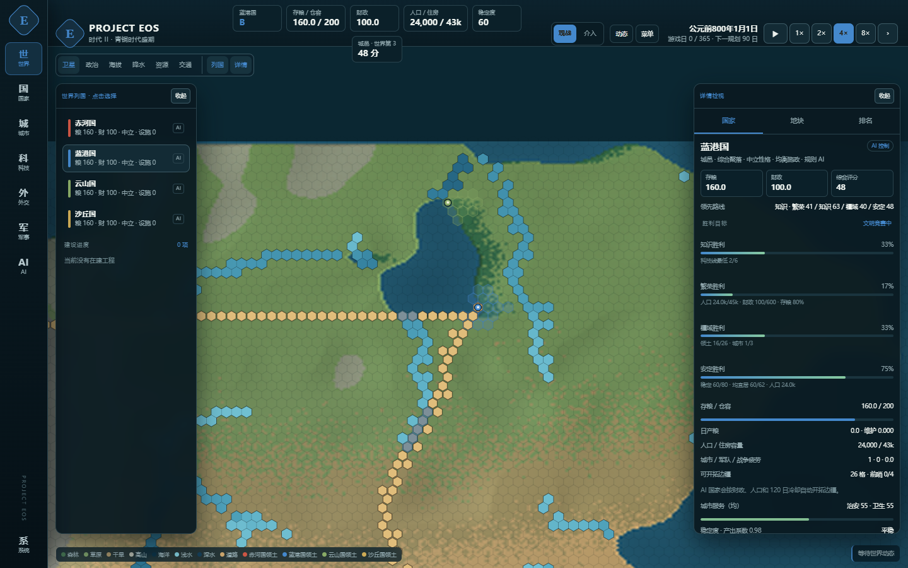

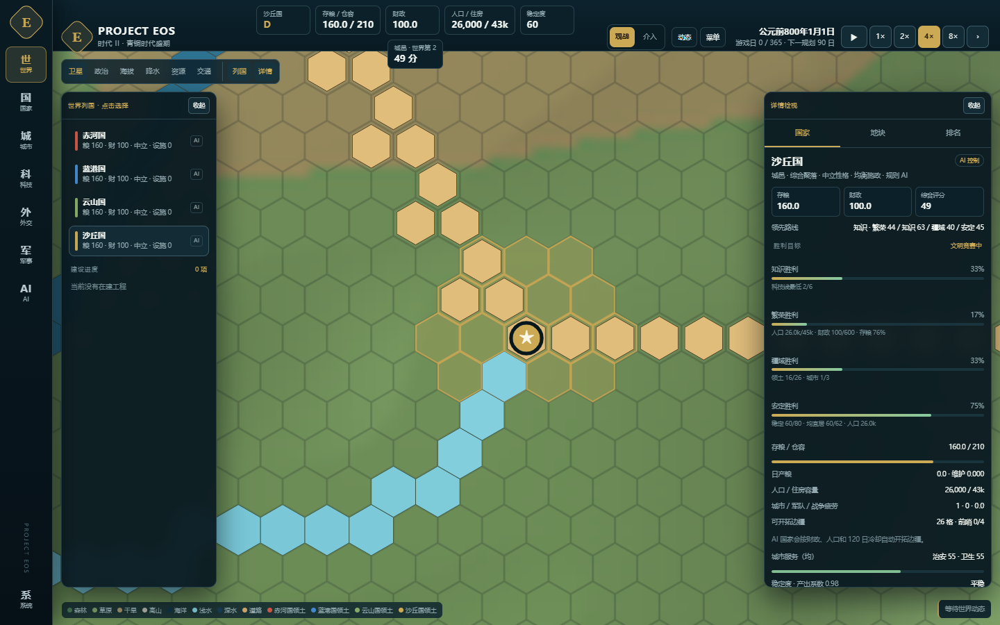

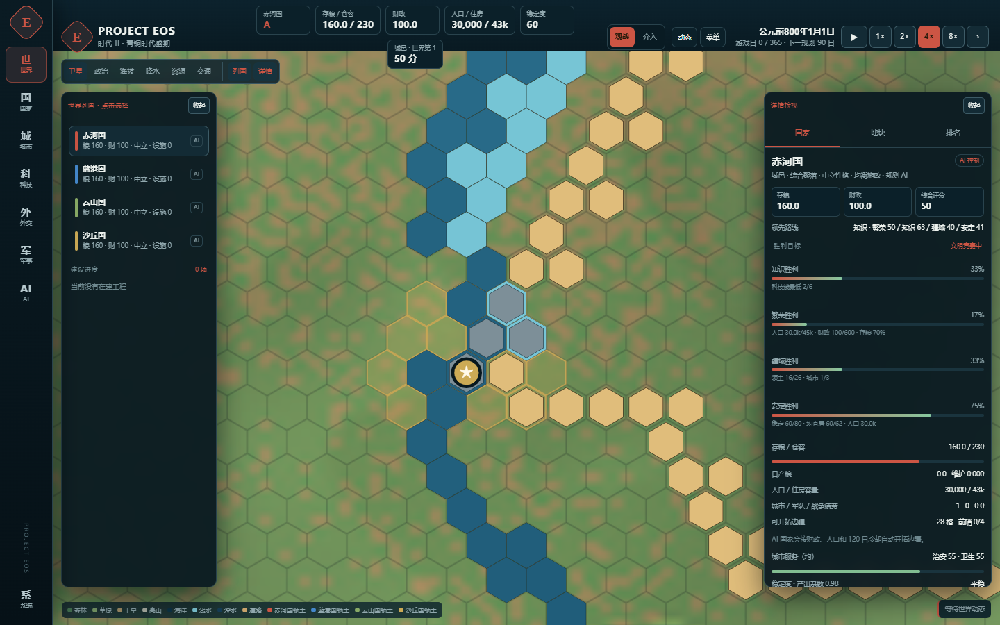

### 4.6 水文重置：蜿蜒河道与内湖（v0.33）

- 河流不再直接取“汇水面积 ≥ 阈值”的掩膜。生成器先把河网拆成支流—干流河段，再对每段生成平滑曲线和正弦横向偏移，最后量化为六邻接的河格；端点与汇流点固定，保证河网连通。
- 每段弯曲被限制在自身河谷走廊内，并为其他河道预留间距，避免多条河段叠成一片宽水面；主河道维持约一格宽，弯道在 1–2 格范围内摆动。
- 湖泊来自两处：地图内部封闭洼地生成 4–17 格的洼地湖，连续地形中不连通外海的封闭水域也登记为内湖（4–29 格）；湖面高程按洼地/水域最低点与湖岸确定，`lake_cells.depth_m` 保留 1–12 m 的水深数据。
- 内流河由局部优先洪泛生成：湖泊周围划出封闭集水区，河流在湖岸终止，`kind=endorheic`、`terminal_lake_id=LKxx`；其他河流为 `exorheic`，最终入海。
- UI 把河流与湖泊统一绘制为海水蓝，不再按水深分色；地块详情仍显示“内流湖”“内流河 · 注入 LKxx”、水深、覆盖率、流域面积；建城条件排除湖格。道路改为陶土红棕色，桥梁为青灰色。
- 审计世界 40004：8 个内湖、111 个湖格、948 个河格（362 个内流河格、22 个内流网络）、132 个道路格。365 天 Mock 模拟通过，城心全部为干地；99 项 pytest 全绿。

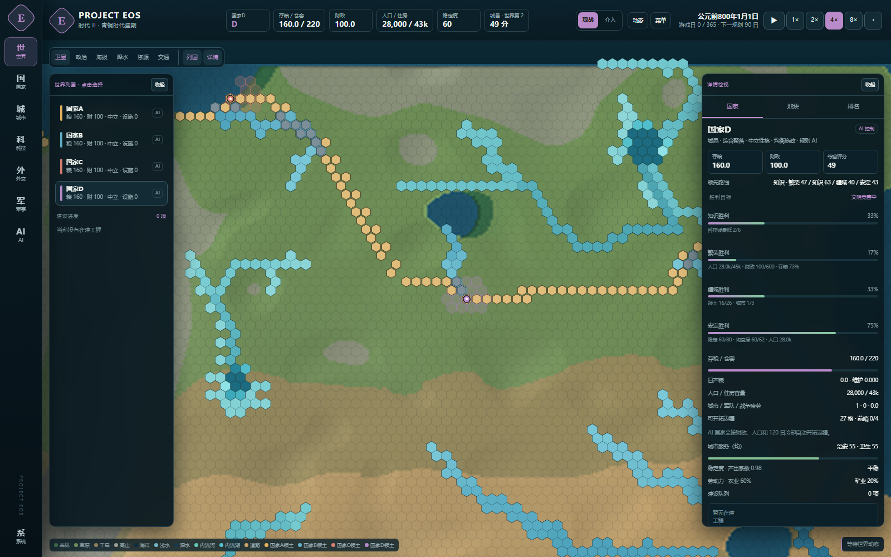

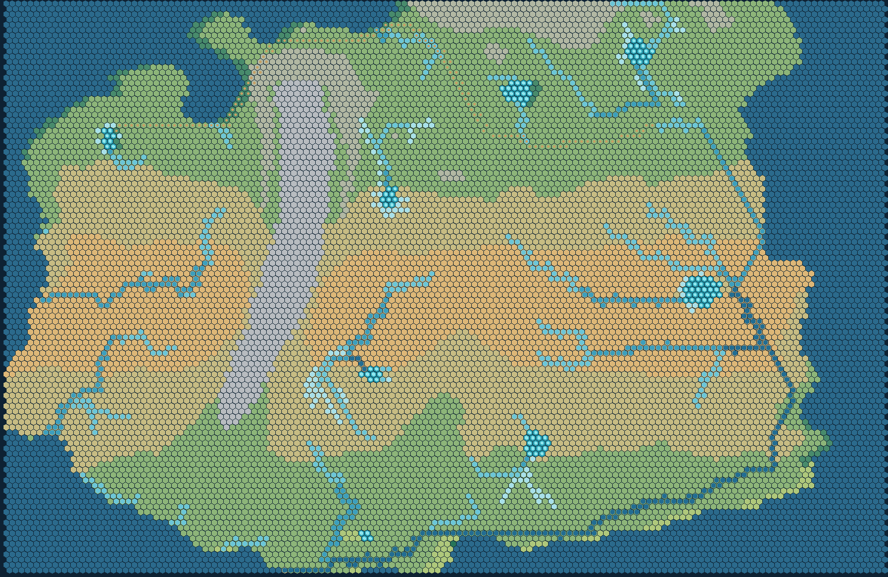

### 4.7 六边形先铺、地形后填（v0.34）

- 新世界不再先生成 576×432 连续地形再量化，而是直接在 144×108 六边形网格上采样地形、气候、水文和灾害；每个六边形只得到一个地形/生物群系。
- 卫星图取消连续地形底图，按六边形填充地形色，并用邻格高程做明暗、对海岸线做描边。海岸、生物群系边界、海洋和湖泊边缘都沿六边形边，不再出现亚格锯齿。
- 海洋和湖泊仍是六边形水体；河流仍只占一格宽，保留蜿蜒、内流河和内流湖；道路也直接落在六边形格上。
- 生成时间从约 20–50 秒降到约 1–2 秒；世界文件不再包含 576×432 地形数组，从约 19 MB 降到约 8 MB。
- 旧 v2 世界和存档继续可载入；新世界默认使用 v3，metadata 标记 `schema_version: 3`、`generator: mapgen_v3_hexfirst`、`terrain_mode: hex_fill`。
- 审计世界 50002：6 个内湖、881 个河格（226 个内流河格）、112 个道路格；公平度 0.8157；365 天 Mock 模拟通过，城心全部为干地；103 项 pytest 全绿。

### 4.7.1 道路连通与外交门槛（v0.35）

- 初始 `road_cells` 作为历史路网参与物流：拥有初始路网的国家获得一份基础物流减损，但不会把每个初始路格都当作 `ROAD` 建筑，避免开局住房/治安被路格数量放大。
- AI 与玩家修路都必须与本国城市、已有 `ROAD` 建筑或相邻道路节点相连；规则在 `core/rules.py` 中返回 `ROAD_NOT_CONNECTED`，从源头阻止断头路。
- 新增外交等级：敌对 / 冷淡 / 中立 / 友好 / 同盟，关系阈值 -100 / -30 / 0 / 25 / 60；`road_connection_level=3`。跨边界连通不同国家路网需要达到友好（关系 ≥ 25），否则返回 `ROAD_DIPLOMACY_REQUIRED`。
- 初始世界路网视为历史基线，保留原有连通；玩家新建道路受门槛约束。规则实现集中在 `core/road.py` 的 `road_node_owners` / `road_connection_status`，UI 用同一套逻辑计算按钮可用性与拒绝原因。
- 已修道路不能覆盖初始道路格；其他设施也不能建在初始道路格上，返回 `ROAD_TILE` / `ROAD_EXISTS`。玩家从本国城市/道路向外延伸仍始终可行。
- 道路渲染改为全局路网取链 + 确定性多频率弯曲噪声：细陶土色线、自然弯曲、非重复 S 形；起点、终点、岔路口保持准确。
- 验证：加载 `save_1794547249538_50002` 正常；关系 0 时跨边界修路被 `ROAD_DIPLOMACY_REQUIRED` 拒绝，关系调至 30 后放行；玩家从本国都城相邻格修路成功，UI 按钮与后端规则一致。

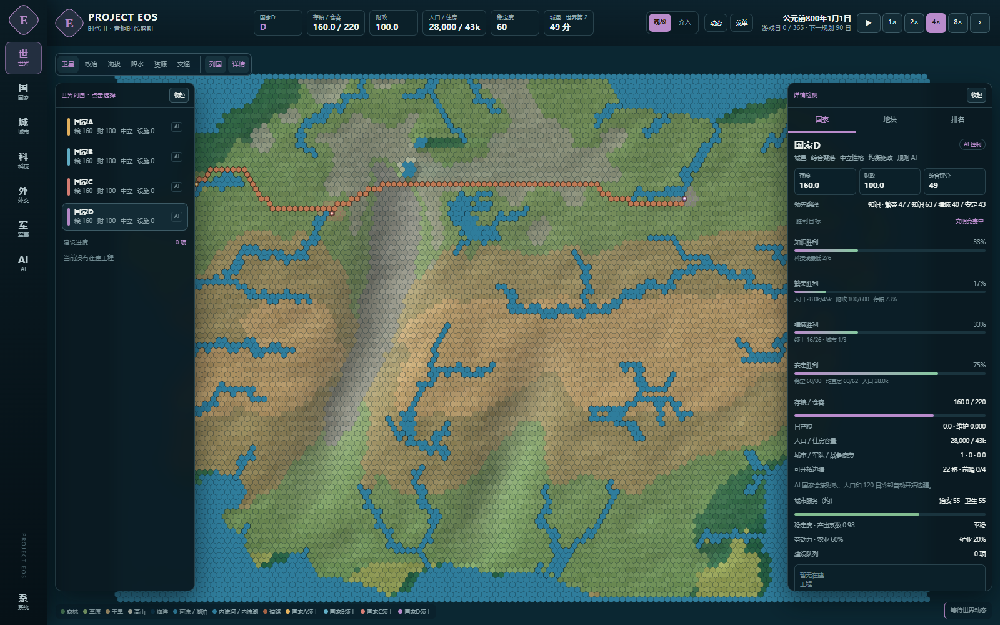

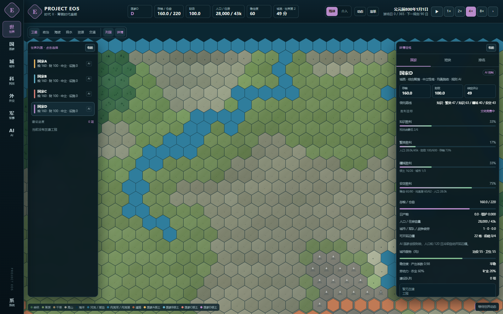

### 4.8 UI

- 一级导航：世界、国家、城市、科技、外交、军事、AI、系统；每个入口打开独立全屏 deck。
- 二级标签：国家（概览/城市/排名）、城市（列表/规划）、科技（总览/三线）、外交（关系/提案）、军事（军队/战争）、AI（席位/档案）、通知（动态/工程）。
- 世界页：全幅地图 + 可收起的列国/详情浮动侧栏；通知改为右下角气泡与顶部未读角标，不再占用常驻侧栏。
- 地图：卫星/政治/海拔/降水/资源/交通；卫星图层叠加国家领土色、边界、水深河格与占格道路；城市标记、无背景设施图标、施工进度。
- 城市详情：局部六边形地图、粮食账本、地方预算、服务条、分区编辑、城内地块建造。
- 美术：11 个设施图标通过本机 GPT Image Studio 重新生成，透明背景、统一 320×320；道路保持线稿。
- Esc 暂停菜单；AI 席位；AI 统治档案；地图决策气泡。
- 新建世界支持 2–12 国增减，默认国家A/B/C/D…

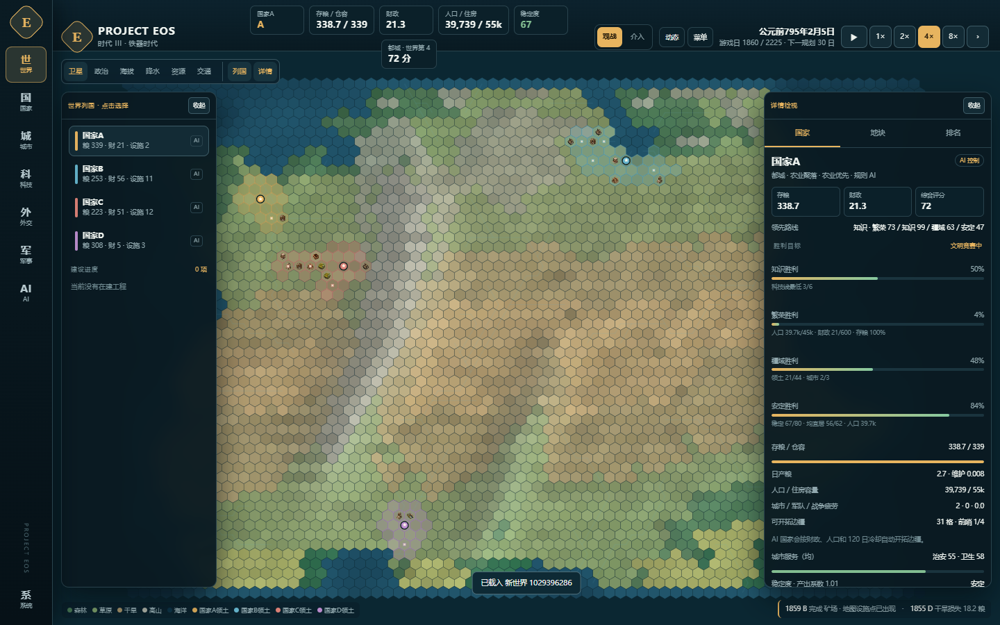

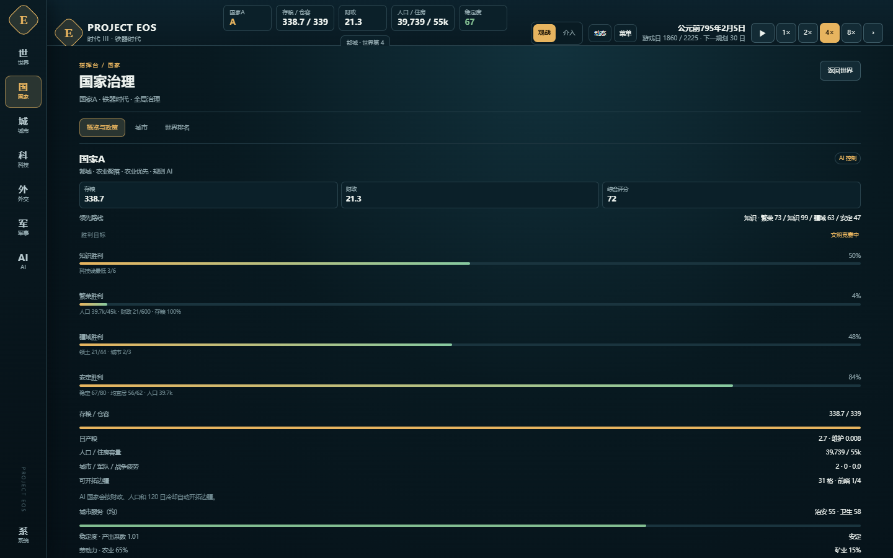

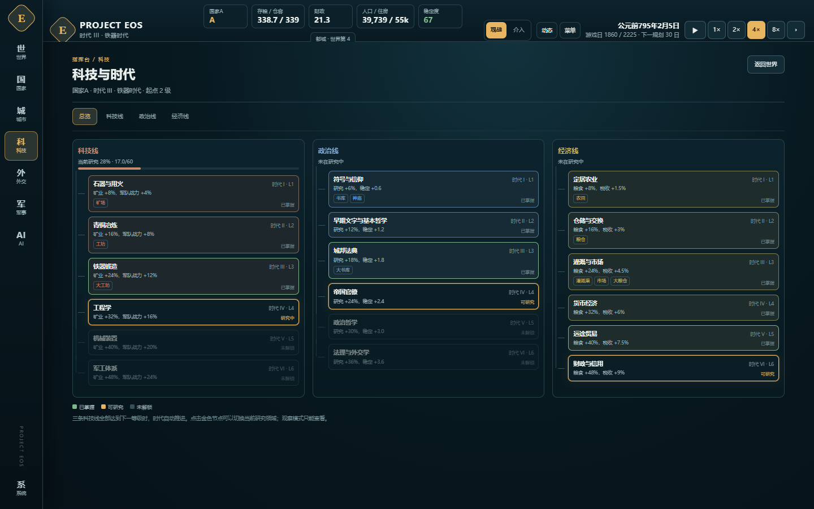

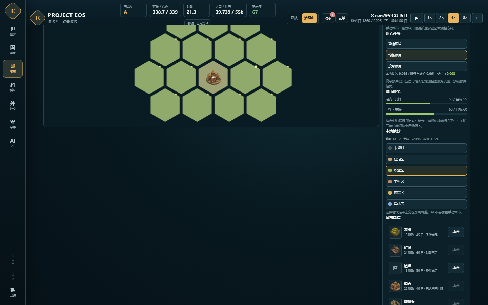

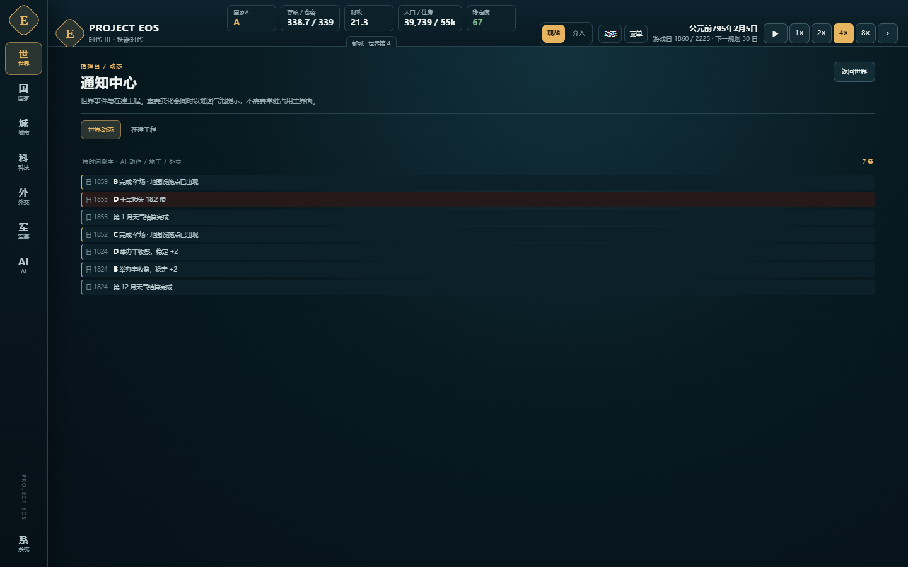

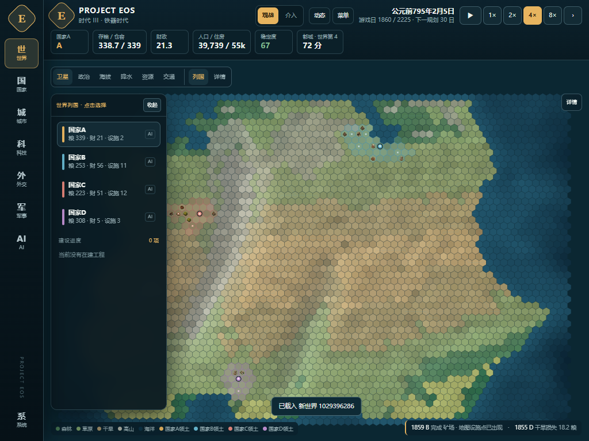

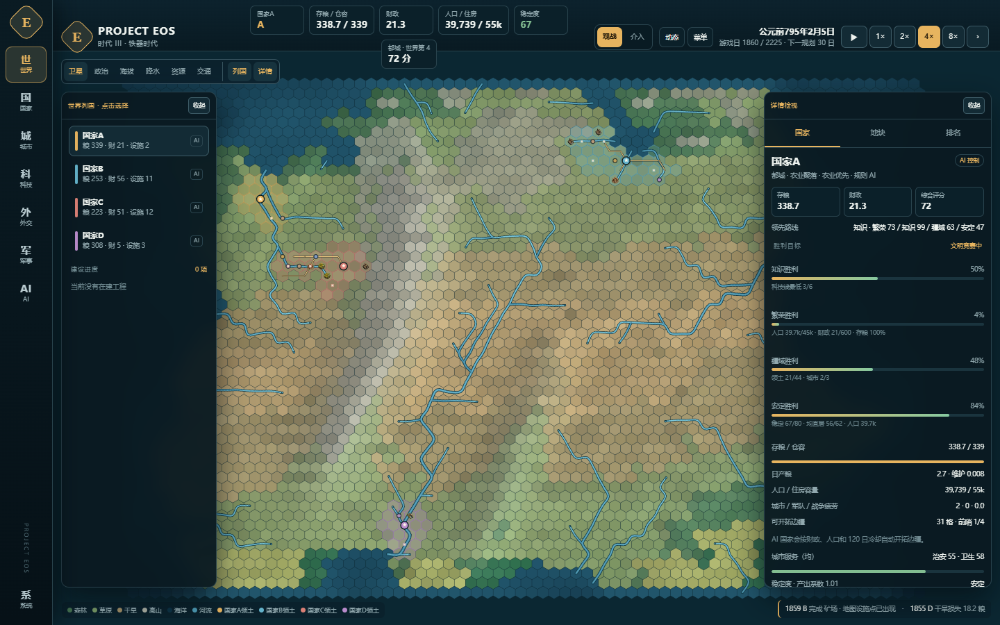

---

## 5. AI 系统

### 5.0 AI 性格

- 每国拥有 `personality`：`aggressive` 激进、`neutral` 中立、`conservative` 保守，默认中立并写入存档。
- Mock 规则 AI 在军备、扩张、赠礼、协定、宣战、贸易、建筑、劳动力上读取性格参数；城市市长读取性格决定方针与预算。
- LLM 系统提示在动作协议之前注入性格说明，要求同一 JSON 协议下体现不同风险偏好。
- AI 席位页逐国切换性格，不需要重填 API Key；国家列表、国家详情同步显示。
- 性格只影响决策偏好，不改变规则审核、资源结算或胜负条件。

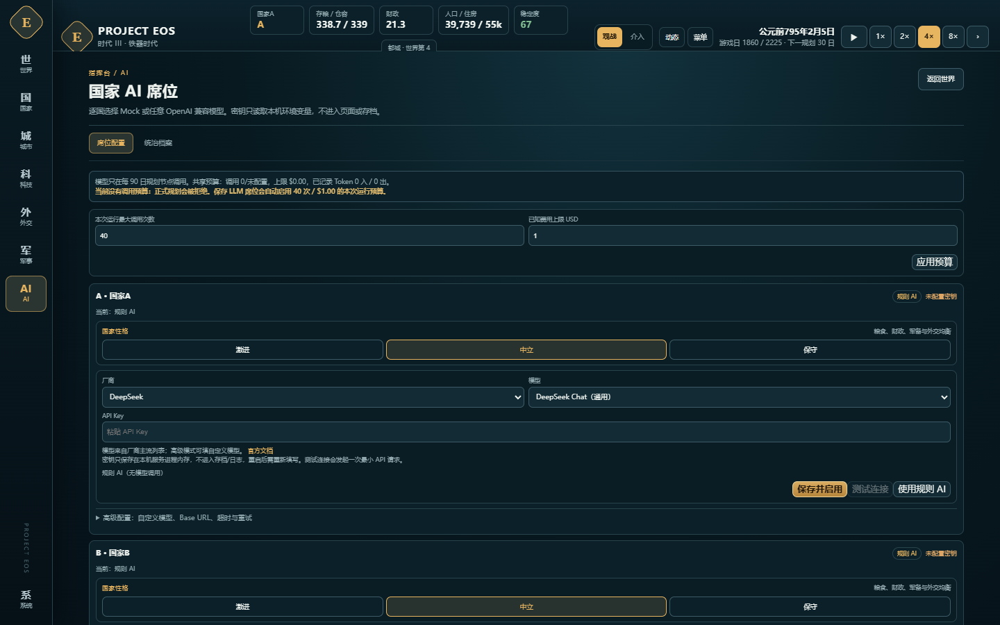

### 5.1 Mock 规则 AI

- 四国（及新世界国家）都有确定性偏好与回退策略。
- 会研究、建造、扩张、贸易、外交、建军、开战/求和、设置城市方针/预算。
- 未知国家 ID 使用确定性回退偏好，不因缺少配置崩溃。
- 目前是基线强度；用户已明确下一步要重点优化 Mock AI 策略深度。

### 5.2 LLM 适配层

- OpenAI 兼容 `/chat/completions`。
- 每家可配置 provider/model/base_url/api_key_env/超时/重试/输出上限/价格。
- 密钥只从进程环境读取；失败回退 `NO_OP`，不中断世界。
- 调用预算、Token、估算费用、错误类型记录。
- 单次决议最多 4 个动作。

### 5.3 简单 / 高级模式

**简单模式**

- 选厂商 → 选模型 → 粘贴 API Key。
- Base URL/默认参数由官方预设填充。
- 密钥只写入本机服务进程内存；不进入存档/日志/`/api/state`/Git，不回显。
- 重启服务后需重新填写。
- 切换厂商但 Key 留空时拒绝，避免旧 Key 发错厂商。

**高级模式**

- 自定义 provider/model/base_url/env var/timeout/retry/output tokens。
- 适合第三方网关、私有部署、特殊模型。

**厂商预设**

- DeepSeek
- 字节豆包（火山方舟）
- 阿里千问（百炼 OpenAI 兼容）
- 月之暗面 Kimi
- 智谱 GLM
- MiniMax

**模型下拉**

- DeepSeek Chat / Reasoner
- 豆包 Seed 2.1 Pro / Turbo
- 千问 Plus / 3.8 Max / 3.8 Flash / Turbo
- Kimi Moonshot v1 Auto / K3 / K2.6
- GLM 5.3 / 5.3 Flash / 5.3 FlashX
- MiniMax M3 / M2.7 / M2.7 Highspeed / M2.5

模型列表在 `config/llm_providers.json`，后续更新不改引擎。具体可用性以各账号控制台为准。

### 5.4 连接测试与状态

- `POST /api/agents/test`：对当前席位发起一次 `max_tokens=8` 的最小请求。
- 返回成功/失败、HTTP 状态、延迟、模型、错误信息；不返回 Key/请求头。
- 最近一次规划调用失败也显示在席位。
- Mock 席位忽略历史 LLM 错误，避免误显示“调用失败”。
- 修复“测试成功、规划 BudgetExceeded”：UI 首次保存 LLM 席位时，若无 CLI 预算，自动启用本次运行 40 次 / $1.00 预算；席位顶部可修改预算。

### 5.5 LLM 统治日记

- 每次 90 日规划，模型返回 `diary: {title, mood, text}`。
- `text` 是第一人称公开决策叙事：局势、动机、取舍、下一步；不要求逐步推理链。
- 记录为 `llm_diary` 事件；不进入回放指纹。
- 只有 LLM 国家生成；Mock 国家没有日记。
- 载入存档保留当前 LLM 席位，不把已配置模型重置为 Mock。

### 5.6 AI 边疆扩张与地图短讯

- 90 日 LLM 日记只进入“AI 统治档案”，不再作为地图气泡；避免四国在规划日同时刷屏。
- `core/messages.py` 监听战争、战斗、停战、贸易、赠礼、建城、工程、科研、缺粮、动荡、疫病、招兵、灾害等事件，立即生成白话短讯。
- 每国 12 游戏日冷却，危机事件可突破；玩家国家不生成 AI 短讯。
- AI 边疆办公室在 `core/frontier.py`：前哨 <4、人口 ≥10,000、财政 ≥ 开拓费+20、距上一座新城 ≥120 日时，自动选择相邻无主陆地执行 `SETTLE`；玩家接管国家跳过。回放时关闭自动边疆，只重放动作日志。
- 气泡仍保留高亮→常亮→淡出、悬停救回、点击展开、关闭归档的交互。

- 都城上方思考气泡，不把右侧日志作为主表现。
- 状态机：
  - `highlight` 2.2 秒脉冲提醒；
  - `steady` 常亮 5.2 秒；
  - `fade` 0.9 秒淡出；
  - 自动归档。
- 鼠标移入：取消高亮，转常亮。
- 鼠标移出：1.2 秒后淡出。
- 淡出过程中触碰：停止消失，恢复常亮。
- 单击：展开完整决策（正文、动作、模型信息），钉住。
- 关闭：气泡移除，内容仍保留在“AI 统治档案”。
- 同时最多 2 个，其余排队；同国新决策替换旧气泡。
- 载入存档只归档历史，不补弹旧气泡。

---

## 6. 多国架构

- 固定基线仍为四国历史剧本（ELAR/MARIS/VAYR/SAHAR）。
- 新建世界支持 2–12 国，使用通用 ID A/B/C…，默认名国家A/B/C…
- 地图生成、颜色、公平度统计、AI 席位、日记、外交、城市管理、排名均按实际国家列表动态处理。
- 前四国保留调优偏好；未知国家 ID 使用确定性回退。
- 新建世界面板可添加/移除国家，颜色自动分配，最多 12 国。
- 六国世界已有生成 + 引擎加载回归测试。

---

## 7. 最终效果与验证

### 7.1 自动化测试

当前 **103 passed**，覆盖：

- 世界完整性、气候、连通、天气样本
- 公平随机地图、六国世界、动态引擎加载
- 建造、科研、政策、交易、外交、军事、城市、预算、动作原子性
- 日历、暂停/倍速、存档、世界哈希、经济、评分、胜利、灾害
- Agent 观察隔离、玩家跳过、回放、断点续跑
- OpenAI 兼容协议、重试、预算、Usage、混用、失败回退
- 厂商预设、模型选择、Key 不进入载荷、连接成功/401、自动预算/预算更新
- LLM 日记记录、Mock 不写日记、日记气泡后端事件

### 7.2 长期平衡实验

**1,825 日实验（v23）**

- 胜者：VAYR，疆域胜利。
- VAYR：39 格领土、5 城、人口 16,649、财政 2,734.5、科技 4/4/3。
- ELAR：24 格、2 城、人口 39,942、财政 11.4。
- MARIS：17 格、2 城、人口 22,412、财政 15.2。
- SAHAR：24 格、2 城、人口 30,202、财政 11.1。
- 未出现粮食短缺失控；VAYR 矿业财政仍是后期主要不平衡点。

**365 日城市服务实验（v22）**

- VAYR 都城卫生约 40.7、治安 46.2。
- AI 市长把部分工矿地块转为住宅，并维持投资预算。
- 服务分化可见但未导致城市崩溃。

### 7.3 关键截图

- 世界地图与胜负面板：`docs/report_assets/victory_panel_country.png`
- 城市粮食账本：`docs/report_assets/city_food_ui.png`
- 城市预算：`docs/report_assets/city_budget_ui.png`
- 城市治安/卫生：`docs/report_assets/city_services_ui.png`
- LLM 统治档案：`docs/report_assets/llm_diary_ui.png`
- 地图思考气泡（高亮）：`docs/report_assets/llm_bubble_highlight.png`
- 地图思考气泡（展开）：`docs/report_assets/llm_bubble_ui.png`
- 厂商/模型选择：`docs/report_assets/llm_model_select_ui.png`
- API 预算与状态：`docs/report_assets/llm_budget_ui.png`
- 多国开局：`docs/report_assets/new_world_generic_names.png`

### 7.4 当前实际可玩闭环

```text
主菜单 → 新建/载入世界
  → 接管一个国家（观战亦可）
  → 暂停/倍速/单步
  → 调整税率、科研、政策、劳动力
  → 建造设施/道路/奇观
  → 开拓新城、规划城市分区/方针/预算
  → 观察粮食、宜居、治安、卫生、财政
  → 外交赠礼/贸易/协定，或战争/占领/和平
  → 达成胜利条件或阶段结算
  → 存档、回放、继续
```

---

## 8. 协作与运行状态

### 8.1 GitHub

- 公开仓库：<https://github.com/xd666-afk/PROJECT-EOS>
- 分支：`main`
- 作者邮箱：GitHub noreply
- 当前本地 `main` 领先远端若干提交；最近一次推送因 GitHub `502` 按用户规则停止，没有反复重试。
- 网络失败策略：只尝试一次，保留本地提交，立即报告，不自动切换代理/循环重试。

### 8.2 本地启动

```bash
cd D:\CCCQoder\project_eos\Project_Eos_Map_Generation_v0.1
./.venv/Scripts/python -m pytest -q
./.venv/Scripts/python live_server.py --days 365 --speed 2 --paused
```

浏览器：`http://127.0.0.1:8765/`。

全 Mock 零费用；需要真实模型时在“AI 席位”里配置厂商/模型/Key，并确认预算。

### 8.3 密钥与安全

- API Key 只存在本机服务进程内存。
- 不进入存档、事件日志、`/api/state`、Git 或页面回显。
- 重启服务后需要重新填写。
- 本地服务无认证，只监听 `127.0.0.1`；禁止直接暴露公网。
- 远程协作方案已移除；协作以 GitHub 为主。

---

## 9. 遗留问题与下一步

### 9.1 优先级最高

1. **Mock AI 深度优化。** 大多数玩家不会申请 Key；需要更强的长期规划、扩张节奏、外交/战争判断、城市经营和反雪球能力。
2. **真实厂商 API 验收。** 六家预设、模型列表和连接测试已完成，但尚未用各厂商真实账号逐一验证；不同账号的模型开通情况可能不同。
3. **城市服务设施。** 当前治安/卫生是抽象指标，还没有卫生所、治安所、消防等独立设施与事件链。
4. **城市物资库存与城市间物流。** 粮食账本和地方预算已有，但还没有完整商品库存/运输网络。

### 9.2 中期

- 多军团、海军、围城、补给线、战争目标。
- 正式动画、音效、过场、胜利演出。
- 时代专属建筑/单位/政策、更多剧本与目标模式。
- 前端拆分组件化，降低 `dashboard.html` 冲突。
- 存档格式迁移框架、事件日志归档。
- 长期 AI 行为与平衡回归（365/1,825 日自动报告）。

### 9.3 已知风险

- 后期矿业专精国家财政仍可能过度积累。
- 战争在和平条件下发生频率偏低。
- 城市服务/预算参数仍需要更多长局验证。
- 真实 API 调用受网络、账号权限、模型开通和价格影响；简单模式默认模型不保证所有账号可用。
- 单文件前端和单机 HTTP 服务适合原型，不是最终发行架构。

---

## 附录 A：关键命令

```bash
# 全测试
./.venv/Scripts/python -m pytest -q

# 全 Mock 实时观察台
./.venv/Scripts/python live_server.py --days 365 --speed 2 --paused --open

# 批处理 365 日
./.venv/Scripts/python run_simulation.py run --days 365

# 带预算的 LLM 服务
./.venv/Scripts/python live_server.py --days 365 --speed 2 --paused \
  --models config/models.deepseek.json \
  --api-key-file "/path/to/local-key" \
  --max-calls 40 --max-cost-usd 1.00

# 地图重建（不要覆盖 output/）
./.venv/Scripts/python worldgen.py --seed 2000 --output output_regenerated
```

## 附录 B：关键文件

```text
core/state.py                 数据模型、存档、summary、胜利
core/rules.py                 唯一写入口、日推进
core/road.py                  道路节点归属、跨边界连通与外交门槛
core/actions.py               动作 schema
core/economy.py               经济、粮食物流、预算、服务、事件
core/society.py               城市指标、分区、评分、胜利条件
core/city_governance.py       AI 市长
agents/heuristic.py           Mock/规则 AI
agents/llm_adapter.py         OpenAI 兼容适配、预算、日记字段
agents/scheduler.py           90 日规划、日记事件
agents/providers.py           厂商预设解析
live_server.py                HTTP、会话、存档槽、连接测试、预算
dashboard.html                单页 UI、地图、城市、AI 席位、气泡
config/rules.json             平衡参数
config/llm_providers.json     厂商/模型预设
output/world_2000BCE.json     不可覆盖的静态世界基线
mapgen_v3.py                  六边形先铺的世界生成器（新世界默认）
mapgen_v2.py                  连续地形 + 细六边形生成器（旧世界兼容）
runs/saves/                   存档槽（不入库）
runs/worlds/                  自定义随机世界（不入库）
```

## 附录 C：验证用基线

- 世界：72×54，3,888 格；2,703 陆地；1,185 海洋；289 河流格。
- 基线四国：ELAR / MARIS / VAYR / SAHAR（历史剧本）。
- 新建世界：2–12 国；通用 ID A/B/C…；默认名国家A/B/C…
- 科技：3 线 × 6 级。
- 默认规划周期：90 日。
- 自动保存：每 30 日。
- 测试：103 项。
- 实时服务默认端口：8765。
- 当前默认 Web 服务：只绑定 `127.0.0.1`，无认证。
